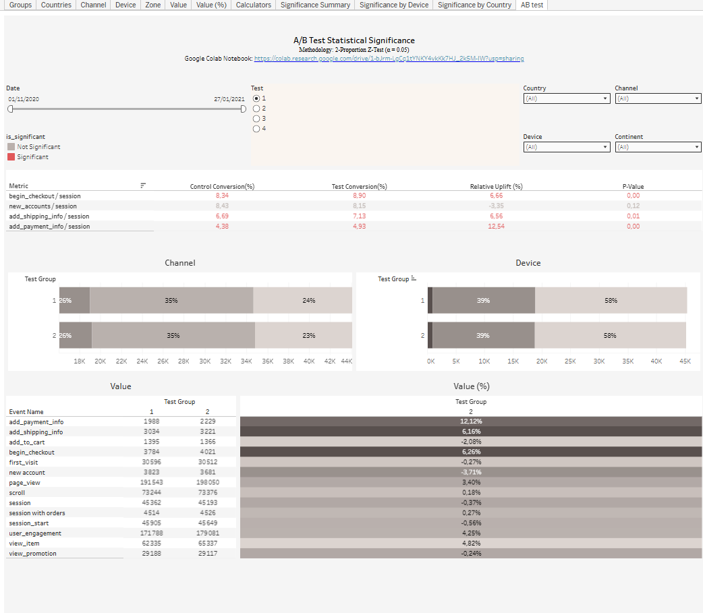

# A/B Test Statistical Significance Dashboard (Tableau)

## Goal
Evaluate the results of an A/B test and check whether the differences between the control and test groups are statistically significant.

## Data
E-commerce user events (sessions, add to cart, checkout, shipping and payment info, new accounts) from 01 Nov 2020 to 27 Jan 2021, split by test group, country, channel, device and continent.

## What I did
- Calculated conversion rates for each funnel step per session in both groups.
- Applied a 2-proportion Z-test (significance level α = 0.05) in Python (Google Colab) to get relative uplift and p-values.
- Built an interactive Tableau dashboard with filters (date, test, country, channel, device, continent), a significance summary, and breakdowns by device and country.

**Tools:** Python (Google Colab), Tableau Public

## Key insights
- Test group conversion is higher for begin_checkout (+6.66%), add_shipping_info (+6.56%) and add_payment_info (+12.54%), and these differences are statistically significant (p ≤ 0.01).
- new_accounts per session is lower in the test group (-3.35%), but the difference is not statistically significant (p = 0.12).

## Dashboard

[Open the interactive dashboard on Tableau Public](https://public.tableau.com/views/ABTestStatisticalSignificance_17918673786320/ABtest?:language=en-US&:sid=&:redirect=auth&:display_count=n&:origin=viz_share_link)

## Files
- `ab_test_analysis.ipynb`: Python analysis (2-proportion Z-test)
- `dashboard.png`: dashboard screenshot
